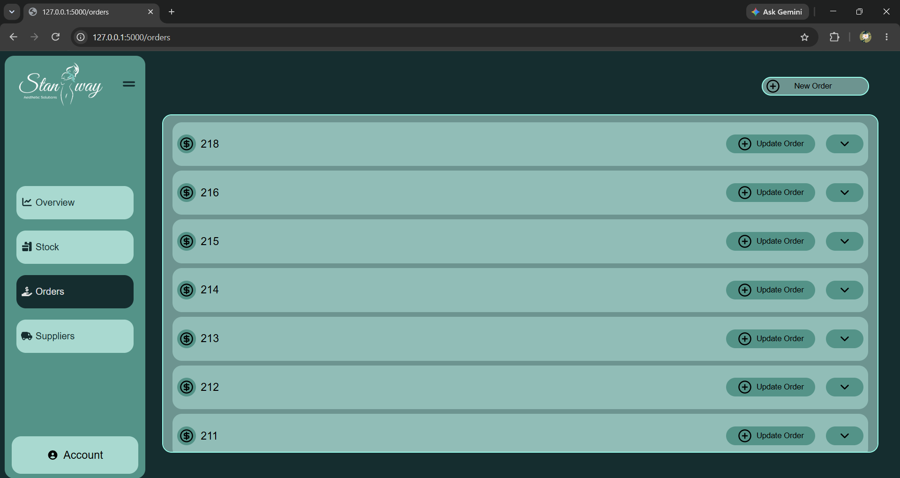
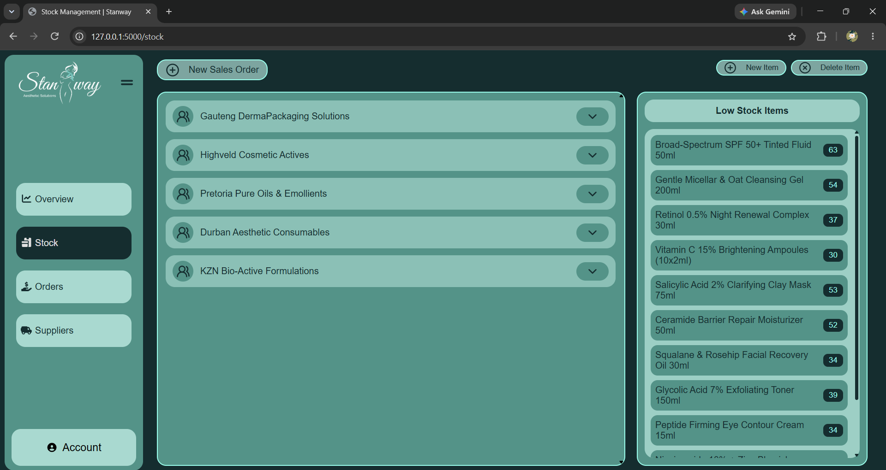
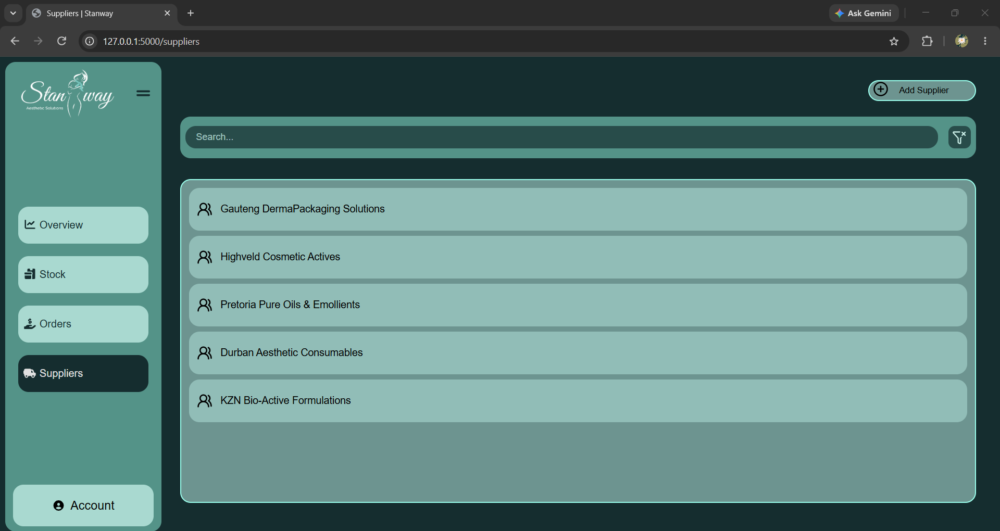

<!-- REPLACE ALL THE [USERNAME] TEXT WITH YOUR GITHUB PROFILE NAME & THE [PROJECTNAME] WITH THE NAME OF YOUR GITHUB PROJECT -->

<!-- Repository Information & Links-->
<br />

<!-- HEADER SECTION -->
<h5 align="center" style="padding:0;margin:0;">Jessica Gazendam u23535662</h5>
<h5 align="center" style="padding:0;margin:0;">Marianne Semmelink u23545420 </h5>
<h5 align="center" style="padding:0;margin:0;">Hannah Moldenhauer u22742477</h5>
<h5 align="center" style="padding:0;margin:0;">Riaan Coetzee u23525283</h5>
<h6 align="center">BFB 321 Group 13</h6>
</br>
<p align="center">
  <h3 align="center">Semester Web Application Project</h3>

  <p align="center">
    Dashboard Design 
  
</p>

<!--PROJECT DESCRIPTION-->
## About the Project
<!-- header image of project -->

### Project Description

Our Web Application for Stanway Solutions.

### Built With

* HTML
* CSS
* JavaScript
* Python Flask
* MySQL

## Getting Started

The following instructions will get you a copy of the project up and running on your local machine for development and testing purposes.

## API Documentation

### Key End-to-End User Flows (Rubric B3)

The application supports three complete user flows spanning Frontend UI $\rightarrow$ Flask REST API $\rightarrow$ Analytical Model $\rightarrow$ MySQL Database:

#### Flow 1: Automated Inventory Reorder & Replenishment (EOQ / ROP Flow)

1. **User Action:** User accesses `/stock` dashboard.

2. **API Trigger:** Frontend issues `GET /api/products`.

3. **Model Calculation:** `models.py` queries historical sales, calculates $\bar{d}$, $\sigma_d$, $SS$, $ROP$, and Wilson $EOQ$.

4. **UI Display:** Items where $Current\_Inventory \le ROP$ are visually put in the to do section for easy reordering. A eoq prediction graph is displayed that uses the eoq to simulate the year for the filtered product based on 5 years historic data. The barchart displays relevant inventory divisions for the filtered product.

#### Flow 2: Purchase Order Procurement Lifecycle

1. **User Action:** User navigates to `/orders` and submits the order creation form.

2. **API Trigger:** `POST /api/purchase_orders` inserts records into `purchase_order` and `purchase_order_item`.

3. **Database State:** MySQL stores order status as `'Pending'`.

4. **UI Update:** The order page dynamically inserts the new order row, updating the "Open Orders" KPI summary badge without requiring a full page reload.

### Endpoint Summary Table

| Method | Endpoint Path | Description / Purpose | Request Body / Query Params | 
| ----- | ----- | ----- | ----- | 
| `GET` | `/api/products` | Retrieve all products with EOQ, ROP, SS, Class & low-stock count | Optional: None | 
| `GET` | `/api/products/<id>` | Fetch single product inventory details | Path: `product_id` | 
| `POST` | `/api/products` | Create a new SKU entry | JSON payload with product details | 
| `PUT` | `/api/products/<id>` | Update product details & pricing | JSON payload with updated fields | 
| `DELETE` | `/api/products/<id>` | Remove product (fails if constrained by sales/POs) | Path: `product_id` | 
| `GET` | `/api/suppliers` | List active suppliers and their assigned products | Optional: None | 
| `GET` | `/api/suppliers/<id>` | Fetch supplier contact card & history | Path: `supplier_id` | 
| `POST` | `/api/suppliers` | Register new supplier entity | JSON payload with contact details | 
| `PUT` | `/api/suppliers/<id>` | Update supplier contact info or replacement link | JSON payload | 
| `DELETE` | `/api/suppliers/<id>` | Delete supplier record | Path: `supplier_id` | 
| `GET` | `/api/sales` | List all recorded sales transactions | Optional: None | 
| `POST` | `/api/sales` | Log customer sale (reduces available stock) | JSON payload (`product_id`, `sale_qty`, `sale_date`) | 
| `PUT` | `/api/sales/<id>` | Modify existing sales record | JSON payload | 
| `DELETE` | `/api/sales/<id>` | Void sales transaction | Path: `sale_id` | 
| `GET` | `/api/purchase_orders` | List purchase orders and count open pending orders | Optional: None | 
| `GET` | `/api/purchase_orders/<id>` | Fetch specific PO with itemized line items | Path: `order_id` | 
| `POST` | `/api/purchase_orders` | Create multi-item procurement order | JSON payload (`supplier_id`, `items`: `[...]`) | 
| `PUT` | `/api/purchase_orders/<id>` | Update PO status (`Pending`, `Received`, `Cancelled`) or items | JSON payload | 
| `DELETE` | `/api/purchase_orders/<id>` | Delete PO record (fails if received inventory linked) | Path: `order_id` | 
| `GET` | `/api/products/<id>/eoq-chart` | Daily inventory trajectory simulation | Query param: `zoom=month|year` | 
| `GET` | `/api/allocation-chart` | Breakdown of Available, Sold, and Future On-Order stock | Query param: `product_id=<id>` | 

### Examples

#### Standard Error Responses
Across all endpoints, unexpected server faults or database exceptions return a standardized error shape:
* **Response (500 Internal Server Error):**
  ```JSON
  {
    "success": false,
    "error": "An internal server error occurred. Please try again."
  }

#### 1. Get All Products
* **Endpoint:** `GET /api/products`
* **Description:** `Fetches a list of all inventory items and their core metrics from the database.`
* **Response Headers:** `Content-Type: application/json`
* **Response (200 OK):** 
  ```JSON
  {
    "count": 13,
    "data": [
      {
        "class": "A",
        "cost_price": 175.0,
        "current_inventory": 63,
        "effective_lt": 6,
        "eoq": 128,
        "holding_cost": 16.0,
        "id": 7,
        "name": "Broad-Spectrum SPF 50+ Tinted Fluid 50ml",
        "revenue": 14190.0,
        "rop": 160,
        "sell_price": 430.0,
        "sold": 0,
        "ss": 51,
        "storage_location": "Aisle B - Shelf 3",
        "supplier_id": 2,
        "year_starting_inventory": 96
      },
      {
        "class": "B",
        "cost_price": 115.0,
        "current_inventory": 54,
        "effective_lt": 5,
        "eoq": 108,
        "holding_cost": 12.5,
        "id": 8,
        "name": "Gentle Micellar & Oat Cleansing Gel 200ml",
        "revenue": 5580.0,
        "rop": 155,
        "sell_price": 310.0,
        "sold": 0,
        "ss": 51,
        "storage_location": "Aisle C - Shelf 1",
        "supplier_id": 2,
        "year_starting_inventory": 72
      },
      ...
    ],
    "low_stock": 12,
    "success": true
  }

#### 2. Get Single Product
* **Endpoint:** `GET /api/products/<product_id>`
* **Description:** `Fetches detailed parameters for a single product by its database ID.`
* **Response (200 OK):** 
  ```JSON
  {
    "data": {
      "class": "A",
      "cost_price": 195.0,
      "current_inventory": 191,
      "effective_lt": 6,
      "eoq": 108,
      "holding_cost": 18.5,
      "id": 1,
      "name": "Hyaluronic Acid Hydrating Serum 30ml",
      "revenue": 6240.0,
      "rop": 125,
      "sell_price": 480.0,
      "sold": 0,
      "ss": 39,
      "storage_location": "Aisle A - Shelf 1 (Cool)",
      "supplier_id": 6,
      "year_starting_inventory": 60
    },
    "success": true
  }
* **Error Response (404 Not Found):** 
  ```JSON
  {
    "success": false,
    "error": "Product not found"
  }

#### 3. Create Product
* **Endpoint:** `POST /api/products`
* **Description:** `Inserts a new inventory item into the MySQL database with an auto-incrementing ID.`
* **Request Header:** `Content-Type: application/json`
* **Request Body (JSON):**
  ```JSON
  {
    "name": "Retinol Serum",
    "price":  320.00,
    "holding_cost": 42.00,
    "starting_inventory": 34,
    "storage_location": "Cooling",
    "supplier_id": 2,
    "supplier_price": 300.00,
    "units_per_package": 16
  }
* **Response (201 Created):** 
  ```JSON
  {
    "data": {
      "class": "C",
      "cost_price": 300.00,
      "current_inventory": 34,
      "effective_lt": 0,
      "eoq": 0,
      "holding_cost": 42.00,
      "id": 13,
      "name": "Retinol Serum",
      "revenue": 0,
      "rop": 0,
      "sell_price": 320.00,
      "sold": 0,
      "ss": 0,
      "storage_location": "Cooling",
      "supplier_id": 2,
      "year_starting_inventory": 34
    },
    "success": true
  }
* **Error Response (400 Bad Request):**
  ```JSON
  {
    "success": false,
    "error": "Missing required fields (name, price, holding_cost, year_starting_inventory, supplier_id)"
  }
* **Error Response (400 Bad Request):**
  ```JSON
  {
    "success": false,
    "error": "Content-Type must be application/json"
  }

#### 4. Update Product
* **Endpoint:** `PUT /api/products/<product_id>`
* **Description:** `Updates product parameters (supports partial updates via dictionary fallbacks).`
* **Request Header:** `Content-Type: application/json`
* **Request Body (JSON):**
  ```JSON
  {
    "price": 299.99
  }
* **Response (200 OK):**
  ```JSON
  {
    "success": true,
    "data": {
      "product_id": 1,
      "name": "Hydrating Face Cream",
      "price": 299.99,
      "holding_cost": 35.50,
      "year_starting_inventory": 100
    }
  }
* **Error Response (404 Not Found):** 
  ```JSON
  {
    "success": false,
    "error": "Product not found"
  }
* **Error Response (400 Bad Request):**
  ```JSON
  {
    "success": false,
    "error": "Content-Type must be application/json"
  }

#### 5. Delete Product
* **Endpoint:** `DELETE /api/products/<int:product_id>`
* **Description:** `Removes a product record from the database by its primary key ID.`
* **Response (200 OK):**
  ```JSON
  {
    "success": true,
    "message": "Product deleted successfully"
  }
* **Error Response (400 Bad Request):**
  ```JSON
  {
    "success": false, 
    "error": "Cannot delete this product because it is linked to existing jobs, sales, or order records."
  }
* **Error Response (404 Not Found):**
  ```JSON
  {
    "success": false,
    "error": "Product not found"
  }

## Prerequisites

* Python 3.10+

* MySQL Server 8.0+

* Git


## Installation instructions
1. **Clone the Repository:**

   ```
   git clone https://github.com/u23535662/BFB321_Group_Project_13
   cd bfb321-final-project-group13
   
   ```

2. **Create and Activate Virtual Environment:**

  (Once)
   ```
   python3 -m venv venv
   ```

   (For every new terminal)
   ```
   # On Mac: source venv/bin/activate  
   # On Windows: venv\Scripts\activate
   
   ```

3. **Install Dependencies:**

   ```
   pip install -r requirements.txt
   
   ```

4. **Environment Configuration (B4.2):**
   Copy `.env.example` to `.env` and fill in local MySQL parameters:

   ```
   cp .env.example .env
   
   ```

   *Edit `.env` settings:*

   ```
   SECRET_KEY=change-me
   DB_HOST=localhost
   DB_USER=root
   DB_PASSWORD=your_mysql_password
   DB_NAME=stock_db
   DB_PORT=3306
   
   ```

5. **Initialize Database & Seed Data (B1.3):**
   Execute the schema and seed scripts:

   ```
   python init_db.py
   
   ```

6. **Run Application:**
  ```
   python app.py
   
   ```

   Open browser at: `http://127.0.0.1:5000`

   
<!-- FEATURES AND FUNCTIONALITY-->
<!-- You can add the links to all of your imagery at the bottom of the file as references -->
## Features and Functionality


### Overview Page



### Stock Page


### Orders page



### Supplier Page


<!-- AUTHORS -->
## Authors and Contributions ##

* **Jessica Gazendam** - [username](https://github.com/u23535662)
Frontend
HTML, CSS, Script
Index, Stock, Orders pages
Popups
* **Marianne Semmelink** - [username](https://github.com/u23545420-debug)
Backend, Flask
Python, MySQL, JavaScript 
APIs
* **Hannah Moldenhauer** - [username](https://github.com/u22742477-Hannah)
Frontend
HTML, CSS, JavaScript
Supplier page
Popups
* **Riaan Coetzee** - [username](https://github.com/RiaanStudent)
Backend, Flask
Python, MySQL, JavaScript 
Database,  JSON

