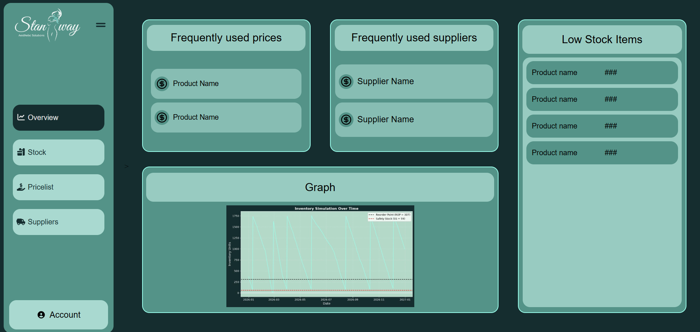
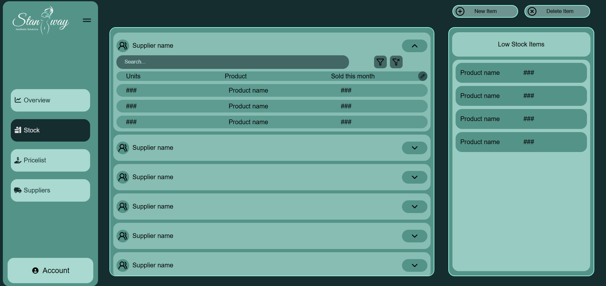
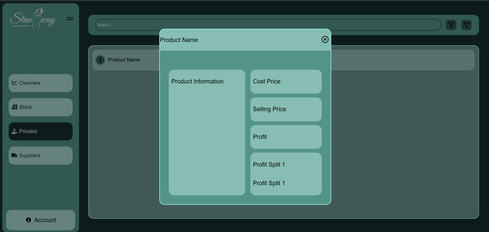
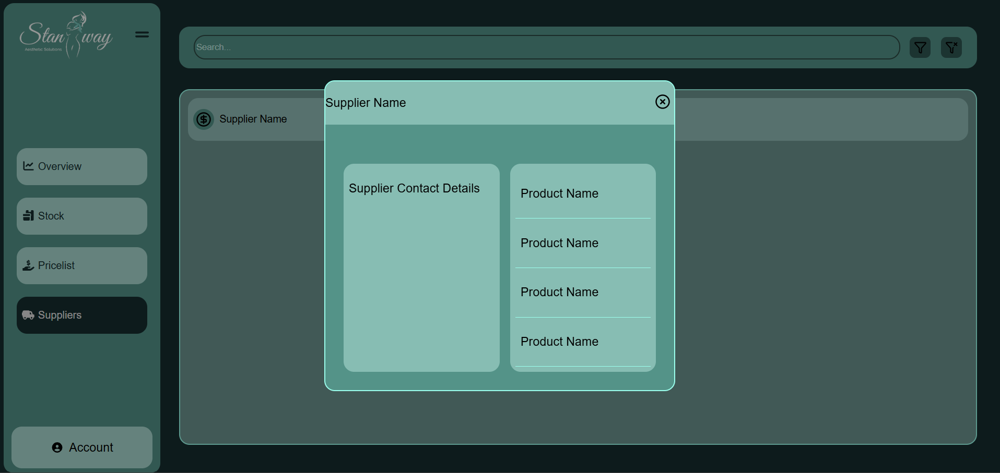

<!-- REPLACE ALL THE [USERNAME] TEXT WITH YOUR GITHUB PROFILE NAME & THE [PROJECTNAME] WITH THE NAME OF YOUR GITHUB PROJECT -->

<!-- Repository Information & Links-->
<br />

<!-- HEADER SECTION -->
<h5 align="center" style="padding:0;margin:0;">Jessica Gazendam u23535662</h5>
<h5 align="center" style="padding:0;margin:0;">Marianne Semmelink u23545420</h5>
<h5 align="center" style="padding:0;margin:0;">Hannah Moldenhauer u22742477</h5>
<h5 align="center" style="padding:0;margin:0;">Riaan Coetzee u23525283</h5>
<h6 align="center">BFB 321 Group 13</h6>
</br>
<p align="center">
  <h3 align="center">Semester Web Application Project</h3>

  <p align="center">
    Dashboard Design 
  
</p>

<!--PROJECT DESCRIPTION-->
## About the Project
<!-- header image of project -->
![image1][image1]

### Project Description

The majority of the frontend design (minus the elements that needs to be linked to the backend) plus our python model.

### Built With

* HTML
* CSS
* JavaScript
* Python

<!-- FEATURES AND FUNCTIONALITY-->
<!-- You can add the links to all of your imagery at the bottom of the file as references -->
## Features and Functionality


### Overview Page



### Stock Page



### Pricelist page



### Supplier Page

<!-- AUTHORS -->
## Authors

* **Jessica Gazendam** - [username](https://github.com/u23535662)
* **Marianne Semmelink** - [username](https://github.com/u23545420-debug)
* **Hannah Moldenhauer** - [username](https://github.com/u22742477-Hannah)
* **Riaan Coetzee** - [username](https://github.com/RiaanStudent)

## API Documentation

### Standard Error Responses
Across all endpoints, unexpected server faults or database exceptions return a standardized error shape:
* **Response (500 Internal Server Error):**
  ```JSON
  {
    "success": false,
    "error": "An internal server error occurred. Please try again."
  }

### 1. Get All Products
* **Endpoint:** `GET /api/products`
* **Description:** `Fetches a list of all inventory items and their core metrics from the database.`
* **Response Headers:** `Content-Type: application/json`
* **Response (200 OK):** 
  ```JSON
  {
    "count": 6,
    "data": [
      {
        "holding_cost": 15.0,
        "id": 1,
        "name": "Botox Cosmetic (100 Units)",
        "price": 350.0,
        "year_starting_inventory": 120
      },
      {
        "holding_cost": 20.0,
        "id": 2,
        "name": "Dermal Filler Hyaluronic Acid (1ml)",
        "price": 450.0,
        "year_starting_inventory": 75
      },
      {
        "holding_cost": 4.0,
        "id": 3,
        "name": "Vitamin C Brightening Serum",
        "price": 85.0,
        "year_starting_inventory": 150
      },
      {
        "holding_cost": 6.0,
        "id": 4,
        "name": "Chemical Peel Solution (Professional)",
        "price": 120.0,
        "year_starting_inventory": 60
      },
      {
        "holding_cost": 3.5,
        "id": 5,
        "name": "Restorative Night Cream",
        "price": 65.0,
        "year_starting_inventory": 180
      },
      {
        "holding_cost": 30.0,
        "id": 7,
        "name": "test",
        "price": 200.0,
        "year_starting_inventory": 20
      }
    ],
    "success": true
  }

### 2. Get Single Product
* **Endpoint:** `GET /api/products/<product_id>`
* **Description:** `Fetches detailed parameters for a single product by its database ID.`
* **Response (200 OK):** 
  ```JSON
  {
    "data": {
      "holding_cost": 15.0,
      "id": 1,
      "name": "Botox Cosmetic (100 Units)",
      "price": 350.0,
      "year_starting_inventory": 120
    },
    "success": true
  }
* **Error Response (404 Not Found):** 
  ```JSON
  {
    "success": false,
    "error": "Product not found"
  }

### 3. Create Product
* **Endpoint:** `POST /api/products`
* **Description:** `Inserts a new inventory item into the MySQL database with an auto-incrementing ID.`
* **Request Header:** `Content-Type: application/json`
* **Request Body (JSON):**
  ```JSON
  {
    "name": "Retinol Serum",
    "price": 320.00,
    "holding_cost": 42.00,
    "year_starting_inventory": 80
  }
* **Response (201 Created):** 
  ```JSON
  {
    "success": true,
    "data": {
      "product_id": 6,
      "name": "Retinol Serum",
      "price": 320.00,
      "holding_cost": 42.00,
      "year_starting_inventory": 80
    }
  }
* **Error Response (400 Bad Request):**
  ```JSON
  {
    "success": false,
    "error": "Missing required fields (name, price, holding_cost, year_starting_inventory)"
  }
* **Error Response (400 Bad Request):**
  ```JSON
  {
    "success": false,
    "error": "Content-Type must be application/json"
  }

### 4. Update Product
* **Endpoint:** `PUT /api/products/<product_id>`
* **Description:** `Updates product parameters (supports partial updates via dictionary fallbacks).`
* **Request Header:** `Content-Type: application/json`
* **Request Body (JSON):**
  ```JSON
  {
    "price": 299.99
  }
* **Response (200 OK):**
  ```JSON
  {
    "success": true,
    "data": {
      "product_id": 1,
      "name": "Hydrating Face Cream",
      "price": 299.99,
      "holding_cost": 35.50,
      "year_starting_inventory": 100
    }
  }
* **Error Response (404 Not Found):** 
  ```JSON
  {
    "success": false,
    "error": "Product not found"
  }
* **Error Response (400 Bad Request):**
  ```JSON
  {
    "success": false,
    "error": "Content-Type must be application/json"
  }

### 5. Delete Product
* **Endpoint:** `DELETE /api/products/<int:product_id>`
* **Description:** `Removes a product record from the database by its primary key ID.`
* **Response (200 OK):**
  ```JSON
  {
    "success": true,
    "message": "Product deleted successfully"
  }
* **Error Response (400 Bad Request):**
  ```JSON
  {
    "success": false, 
    "error": "Cannot delete this product because it is linked to existing jobs, sales, or order records."
  }
* **Error Response (404 Not Found):**
  ```JSON
  {
    "success": false,
    "error": "Product not found"
  }