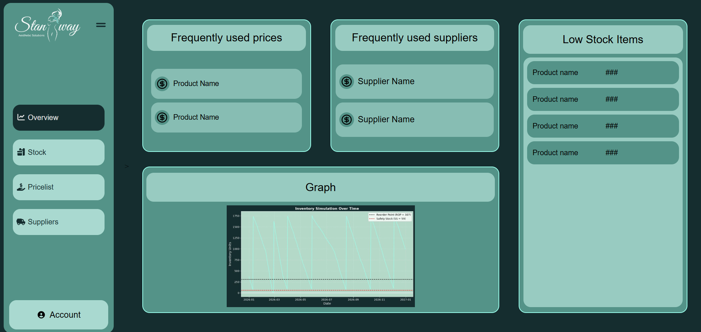
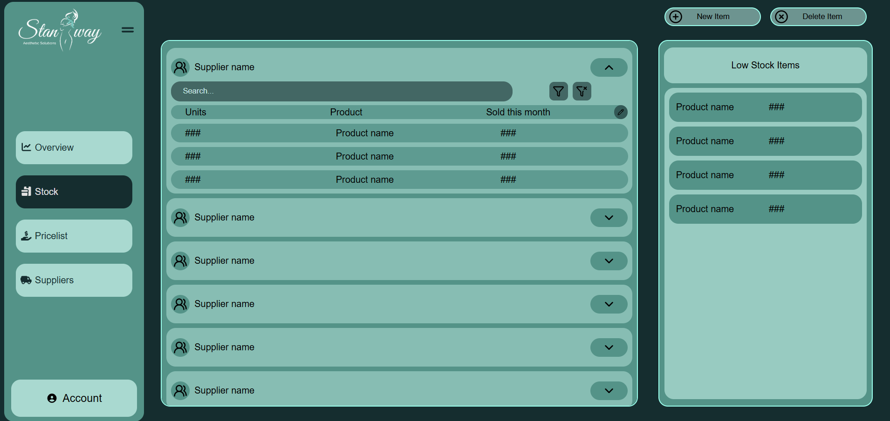
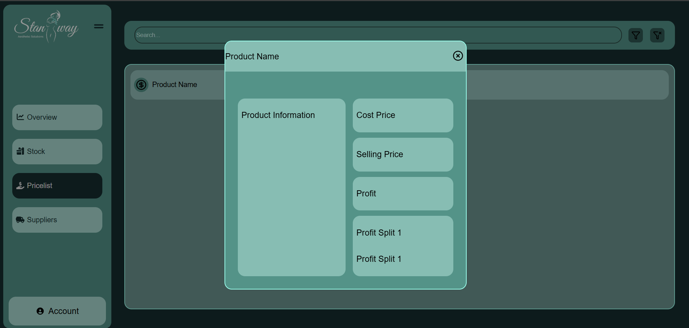
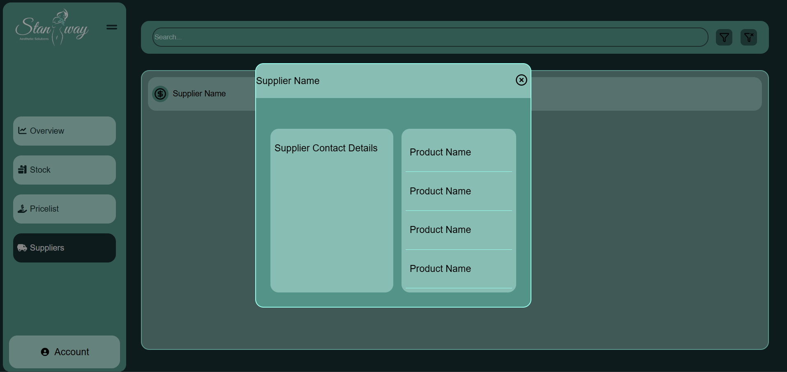

<!-- REPLACE ALL THE [USERNAME] TEXT WITH YOUR GITHUB PROFILE NAME & THE [PROJECTNAME] WITH THE NAME OF YOUR GITHUB PROJECT -->

<!-- Repository Information & Links-->
 

<!-- HEADER SECTION -->
<h5 align="center" style="padding:0;margin:0;">Jessica Gazendam u23535662</h5>
<h5 align="center" style="padding:0;margin:0;">Marianne Semmelink u23545420</h5>
<h5 align="center" style="padding:0;margin:0;">Hannah Moldenhauer u22742477</h5>
<h5 align="center" style="padding:0;margin:0;">Riaan Coetzee u23525283</h5>
<h6 align="center">BFB 321 Group 13</h6>
 

  <h3 align="center">Semester Web Application Project</h3>

  

    Dashboard Design 
  

<!--PROJECT DESCRIPTION-->
## About the Project
<!-- header image of project -->
![image1][image1]

### Project Description

The majority of the frontend design (minus the elements that needs to be linked to the backend) plus our python model.

### Built With

* HTML
* CSS
* JavaScript
* Python

<!-- FEATURES AND FUNCTIONALITY-->
<!-- You can add the links to all of your imagery at the bottom of the file as references -->
## Features and Functionality

### Overview Page

### Stock Page

### Pricelist page

### Supplier Page

<!-- AUTHORS -->
## Authors

* **Jessica Gazendam** - [username](https://github.com/u23535662)
* **Marianne Semmelink** - [username](https://github.com/u23545420-debug)
* **Hannah Moldenhauer** - [username](https://github.com/u22742477-Hannah)
* **Riaan Coetzee** - [username](https://github.com/RiaanStudent)

